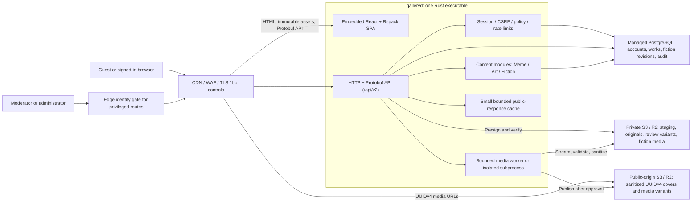
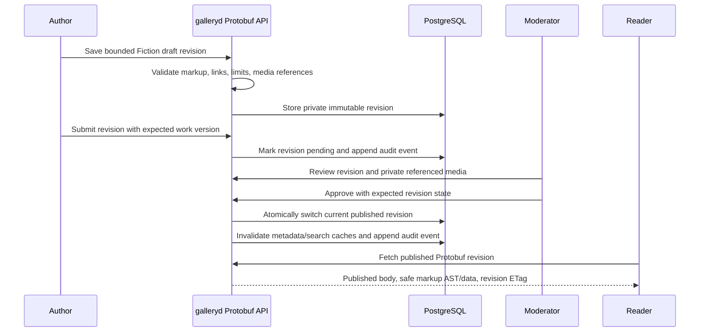
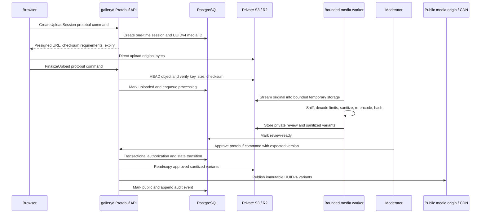

# Hasu Gallery Architecture V2

- **Status**: Approved target architecture; Slice A–C foundations landed in-repo (packaging, public works Protobuf, Fiction domain)
  (proto, galleryd packaging, `/api/v2` health/error smoke). Runtime product
  behavior remains the pre-V2 JSON API + independent SPA until later slices ship.
- **Decision date**: 2026-07-18
- **Scope**: Content domains, application packaging, API transport, persistence,
  media delivery, security, resource limits, and migration sequencing

## 1. Purpose And Status Boundary

Architecture V2 redesigns the production topology without replacing the
existing frontend product architecture.

V2 also expands the long-term product from the implemented Meme + Art baseline
to three first-class content domains:

- Meme;
- Art;
- Fiction, providing Pixiv-novel-like fan-fiction publishing and reading.

The current repository still implements:

- an independently served React/Rspack SPA;
- an Axum JSON API;
- PostgreSQL-backed sessions and application data;
- server-proxied multipart uploads;
- S3/MinIO media objects whose pending and approved URLs currently share the
  same public base.

This document defines the approved target. Until a migration slice is
implemented and verified, current runtime behavior remains authoritative for
operations and tests. Documentation must not describe an unimplemented V2
capability as already shipped.

## 2. Goals

- Deliver the frontend and backend as one production application artifact.
- Support Meme, Art, and Fiction through one identity, moderation, discovery,
  reporting, and audit spine while preserving content-specific models.
- Preserve React 19, Rspack, TanStack Router/Query, zustand, Tailwind v4, the
  shared UI package, and the current product interaction model.
- Run the application tier comfortably on a 1 vCPU / 512 MB origin.
- Use plain HTTP with Protobuf request and response bodies for the V2 business
  API.
- Keep PostgreSQL as the system of record, preferably as a managed service.
- Use an external S3-compatible object store such as AWS S3 or Cloudflare R2.
- Use UUIDv4 identifiers in every public media URL.
- Keep pending and original media private; publish only sanitized variants.
- Put authorization, resource limits, cache policy, and auditability at
  explicit architectural boundaries.
- Minimize application-origin bandwidth and maximize CDN cacheability.

## 3. Non-Goals

- The frontend does not need to remain independently static-deployable.
- V2 does not introduce SSR, Next.js, or a frontend framework migration.
- V2 does not split the application into microservices.
- V2 does not run MinIO on the 1 vCPU / 512 MB production origin.
- V2 does not add a second database implementation. SQLite may be evaluated in
  a separate architecture decision only if PostgreSQL must run locally.
- Protobuf and UUIDv4 are not treated as encryption, authorization, or
  anti-scraping controls.
- Raw user uploads are never a public delivery format.
- Fiction bodies are never accepted or rendered as arbitrary raw HTML.
- V2 does not require an external search service for the initial Fiction
  launch; PostgreSQL-backed search is the baseline.

## 4. Locked Decisions

| Area | V2 decision |
|---|---|
| Application shape | Modular monolith |
| Production artifact | One Rust executable containing the Rspack SPA |
| Frontend | Existing React/Rspack/TanStack/zustand/Tailwind architecture |
| Content domains | Meme, Art, and Fiction |
| API transport | Plain HTTP + Protobuf, not gRPC-Web |
| API version | /api/v2 and package hasu.gallery.v2 |
| API schema source | proto/ with generated Rust and TypeScript types |
| Database | PostgreSQL; managed service recommended |
| Object storage | External S3-compatible storage, including S3 or R2 |
| Media identity | UUIDv4 public media identifier |
| Media visibility | Private originals and review assets; public sanitized variants only |
| Public delivery | CDN/WAF in front of the application and public media store |
| Production CORS | Disabled; frontend and API are same-origin |
| Upload transport | Presigned direct upload to private object storage |
| Media processing | Bounded single-concurrency worker using the same binary artifact |
| Fiction storage | Versioned, bounded, safe-markup text in PostgreSQL |
| Authorization | Central policy layer with deny-by-default decisions |

## 5. Target Architecture

### 5.1 Trust Boundaries

1. The edge is the only public network entry point.
2. The application origin accepts traffic only from the trusted edge or private
   operator network.
3. PostgreSQL is never exposed to the public internet.
4. The private media store is inaccessible without short-lived signed access.
5. The public media store contains only approved, sanitized variants.
6. Browser input remains untrusted after Protobuf decoding and after direct
   object-store upload.
7. Fiction text and markup remain untrusted after decoding; raw HTML is never a
   rendering contract.
8. Moderator and administrator access requires both edge controls and
   application authorization.

## 6. Application Packaging

The production build produces one executable named galleryd.

The build pipeline:

1. Builds the existing Rspack frontend.
2. Emits content-hashed JavaScript and CSS assets.
3. Precompresses static assets with Brotli and gzip.
4. Excludes production source maps from the public artifact.
5. Embeds index.html and static assets into the Rust executable.
6. Compiles database migrations and Protobuf descriptors/generated code into
   the release artifact where practical.

The executable provides:

- galleryd serve: SPA, API, health, and bounded background jobs;
- galleryd migrate: explicit production database migration;
- galleryd media-worker: optional isolated worker subprocess using the same
  binary;
- galleryd doctor: configuration and dependency checks without exposing
  secrets.

SPA routes fall back to the embedded index.html. Production does not require
Node.js, pnpm, MinIO, or a separate frontend server.

Static cache policy:

| Resource | Cache policy |
|---|---|
| index.html | no-cache |
| Content-hashed JS/CSS/fonts | public, max-age=31536000, immutable |
| Favicon and stable metadata | short cache unless content-hashed |
| Source maps | private build artifact only |

## 7. Protobuf API

### 7.1 Transport

V2 uses ordinary HTTP semantics so browser fetch, edge caching, cookies,
request IDs, and existing Axum routing remain straightforward.

- Route prefix: /api/v2
- Protobuf package: hasu.gallery.v2
- Request and response media type:
  application/vnd.hasu-gallery.v2+protobuf
- Rust generation/runtime: prost
- TypeScript generation/runtime: Buf-generated protobuf-es types
- Schema validation: buf lint
- Breaking-change validation: buf breaking

The baseline does not use gRPC-Web. Public reads remain GET requests with
allowlisted query parameters and Protobuf response bodies. Commands use
Protobuf request and response bodies.

Large image bytes never travel inside Protobuf messages. Upload bytes go
directly from the browser to S3/R2 through a presigned request.

### 7.2 Route Families

| Route family | Audience | Cache |
|---|---|---|
| /api/v2/public/* | Anonymous approved/all-ages reads | Public micro-cache |
| /api/v2/auth/* | Authentication and session lifecycle | no-store |
| /api/v2/account/* | Current user's private workspace | no-store |
| /api/v2/uploads/* | Upload session and finalization | no-store |
| /api/v2/moderation/* | Moderator workflow | no-store |
| /api/v2/admin/* | Administrative operations | no-store |

Public endpoints must not inspect cookies or vary output by the current user.
Authenticated mature-content reads use a private route family so public CDN
responses cannot leak role- or session-dependent data.

### 7.3 Message Design

Use dedicated command and response messages instead of exposing database
entities directly.

Required audience-specific response types include:

- PublicUserSummary;
- SelfUser;
- PublicWork;
- OwnerWork;
- ModerationWork;
- PublicFictionSummary;
- PublicFictionDetail;
- OwnerFictionDraft;
- FictionRevision;
- FictionSeries;
- AdminUserSummary;
- ErrorResponse;
- FieldViolation.

Security rules:

- Do not use google.protobuf.Any or Struct in public contracts.
- Reject unspecified or unknown enum values where a value is required.
- Bound every string, bytes field, repeated field, and page size.
- Never reuse deleted field numbers or names; reserve them.
- Do not accept role, review status, uploader ID, object key, or other
  server-owned fields in generic update messages.
- Decode into generated transport types, validate, then map into explicit
  domain commands.
- Never persist or echo unknown fields from a client message.

### 7.4 Limits And Errors

| Control | Target |
|---|---:|
| Default Protobuf request body | 64 KiB |
| Authentication request body | 16 KiB |
| Upload-session request body | 16 KiB |
| Fiction revision request body | 2 MiB decompressed |
| Maximum page size | 50 items |
| Public request timeout | 3 seconds |
| Private command timeout | 5 seconds |
| Media finalization timeout | 10 seconds, excluding asynchronous processing |

Reject unsupported request media types with 415 and unacceptable response
types with 406. Set X-Content-Type-Options: nosniff.

Client request compression is disabled by default. If it is introduced later,
the decompressed size must be bounded before Protobuf decoding.

ErrorResponse exposes a stable product-safe error code, a localized-message key
or safe fallback message, a request ID, and bounded field violations. Internal
SQL, object-store, stack, and credential details remain server-side only.

### 7.5 Fiction API Surface

Target route groups include:

- GET /api/v2/public/fictions;
- GET /api/v2/public/fictions/{work_id};
- GET /api/v2/public/fiction-series/{series_id};
- GET /api/v2/account/fictions;
- POST /api/v2/account/fictions;
- PUT /api/v2/account/fictions/{work_id}/draft;
- POST /api/v2/account/fictions/{work_id}/submit;
- GET /api/v2/moderation/fictions;
- POST /api/v2/moderation/fictions/{work_id}/revisions/{revision_id}/decision.

List responses contain metadata and excerpts only. The full body is fetched only
for a detail/read route. Published revision responses are keyed by revision ID
and ETag; drafts, review copies, reading progress, and mature authenticated
responses use no-store.

## 8. Content Storage Architecture

### 8.1 Fiction Content Model

Fiction is a first-class work kind, not an attachment to the Art gallery.

- A Fiction work is one independently readable text publication.
- A Fiction series orders multiple Fiction works and owns series-level metadata.
- Draft, pending-review, published, rejected, and withdrawn revisions are
  distinct records.
- Editing a published work creates a new private revision. The previous
  published revision remains readable until the replacement is approved.
- The canonical body is UTF-8 text using a constrained Hasu Fiction Markup
  profile, never arbitrary HTML.
- The markup profile may represent paragraphs, line/page breaks, emphasis,
  ruby/furigana, safe HTTP(S) links, and references to approved UUIDv4 media.
- Covers and inline illustrations reuse the private-to-public media pipeline.
  Remote image hotlinks are not a publication format.
- PostgreSQL stores the canonical text, revisions, series ordering, moderation
  state, and search projections. S3/R2 stores only cover/illustration media.

Initial Fiction metadata:

- title and synopsis;
- language;
- source fandom/original work;
- characters;
- relationships/pairings;
- tags;
- shared content rating;
- completion state;
- word/character count;
- optional series membership and position;
- author and safe public attribution.

### 8.2 Fiction Revision And Publication Flow

### 8.3 Fiction Data Model

Target tables:

~~~text
work_fiction_meta
  work_id
  language
  fandom
  synopsis
  content_rating
  completion_state
  cover_media_id
  current_published_revision_id
  word_count

fiction_revisions
  id uuid primary key
  work_id
  author_id
  revision_number
  state
  markup_source
  plain_text_projection
  content_sha256
  word_count
  created_at
  submitted_at
  reviewed_at
  published_at

fiction_series
  id uuid primary key
  owner_id
  title
  synopsis
  state
  created_at
  updated_at

fiction_series_items
  series_id
  work_id
  position

fiction_reading_progress
  user_id
  work_id
  revision_id
  position
  updated_at
~~~

V2 introduces a shared content_kind with meme, art, and fiction values. The
existing gallery_kind and art-only rating model are migrated behind a
compatibility boundary: shared publication policy uses content_kind and
content_rating, while Meme- and Art-specific extension data remain separate.

The existing works constraint that requires file or asset_file is replaced by
content-kind-specific integrity rules: Meme and Art require approved media,
while Fiction requires an approved published revision and may have an optional
cover media reference.

Reading progress is private account data and is not required for the first
public Fiction read slice. It is included here to prevent future progress data
from being mixed into public analytics.

### 8.4 Fiction Safety, Search, And Delivery

- Limit one decompressed Fiction revision request to 2 MiB and 200,000 Unicode
  scalar values; exact lower product limits may be chosen during implementation.
- Parse and validate markup server-side. The frontend renders an allowlisted
  structure and never injects author HTML.
- Allow only HTTP(S) links, add safe external-link attributes, and block script,
  data, file, and other executable URL schemes.
- Inline media references must resolve to media owned/authorized for the author
  and approved for publication.
- Normalize metadata fields for comparison/search while preserving the author's
  canonical body text.
- Use PostgreSQL indexes and pg_trgm-compatible title, author, fandom, tag, and
  excerpt search as the baseline. Full body search may move behind a provider
  interface later, but no search daemon runs on the 512 MB origin.
- Public lists return excerpts, counts, and metadata rather than full bodies.
- Published revision bodies use an ETag derived from revision identity/content
  and may receive a short shared cache TTL.
- Drafts, pending revisions, review notes, and reading progress use no-store.
- Reports and takedowns apply to the work and retain revision/audit history.

### 8.5 UUIDv4 URL Contract

Every public media asset has a distinct UUIDv4 media ID. Work IDs and media IDs
are separate identities.

Canonical public URLs:

~~~text
https://media.example.com/{uuidv4}/v1/thumb-320.webp
https://media.example.com/{uuidv4}/v1/preview-640.webp
https://media.example.com/{uuidv4}/v1/display-1280.avif
https://media.example.com/{uuidv4}/v1/master.jpg
~~~

Rules:

- Use lowercase canonical UUIDv4 strings.
- Do not expose user IDs, work IDs, original filenames, object-store bucket
  names, or content hashes in public URLs.
- Variant names are a server allowlist; arbitrary transform query parameters
  are not supported.
- Public objects are immutable. Reprocessing creates v2 or a new media UUID.
- SHA-256 and perceptual hashes remain internal integrity/deduplication fields.
- UUID unpredictability is not authorization. Private objects remain protected
  even if their UUID is known.

Canonical object keys:

~~~text
private/{uuidv4}/original
private/{uuidv4}/review.webp
private/{uuidv4}/prepared/v1/thumb-320.webp
private/{uuidv4}/prepared/v1/preview-640.webp
private/{uuidv4}/prepared/v1/display-1280.avif
private/{uuidv4}/prepared/v1/master.jpg
public/{uuidv4}/v1/thumb-320.webp
public/{uuidv4}/v1/preview-640.webp
public/{uuidv4}/v1/display-1280.avif
public/{uuidv4}/v1/master.jpg
~~~

### 8.6 Media Upload And Publication Flow

### 8.7 Media Processing Controls

- Stream uploads to bounded temporary files; never collect the full multipart
  or object body into an unbounded Vec.
- Presigned uploads are short-lived and bind the expected private key, maximum
  size, checksum, and one-time upload session.
- Private object-store CORS allows only the canonical application origin and
  required upload methods/headers; wildcard origins are forbidden.
- Process one media job at a time on the 512 MB profile.
- Enforce compressed bytes, dimensions, total decoded pixels, animation frame
  count, total animation pixels, and processing-time limits.
- Reject SVG, PDF, archives, and polyglot/non-image formats.
- Re-encode every public format. Do not pass through raw GIF or WebP containers.
- Strip metadata from every public variant.
- Keep the original private for the minimum required retention period.
- Run the decoder in an isolated galleryd media-worker subprocess when the
  platform supports process limits and sandboxing.
- Temporary files use restrictive permissions and are removed on success,
  rejection, timeout, or crash recovery.

### 8.8 Media Data Model

Target tables:

~~~text
media_assets
  id uuid primary key
  owner_id bigint
  state
  original_object_key
  original_sha256
  detected_mime
  width
  height
  created_at
  updated_at

media_variants
  media_id uuid
  version integer
  variant
  object_key
  mime_type
  width
  height
  byte_size
  sha256

upload_sessions
  id uuid primary key
  media_id uuid
  owner_id bigint
  expected_size
  expected_checksum
  state
  expires_at
  consumed_at
~~~

Meme and Art works reference required primary media assets. Fiction may
reference an optional cover plus allowlisted inline media through explicit join
records. API responses derive URLs from approved media_variants rather than
storing permanent public URLs in works.

## 9. Database And Persistence

PostgreSQL remains the system of record because it already backs the current
schema, sessions, moderation transactions, and query model.

Fiction canonical text also remains in PostgreSQL so revisions, moderation,
series ordering, search projections, audit, and transactional publication stay
consistent. Covers and illustrations remain in the media stores.

Production recommendations:

- Use a managed PostgreSQL service with TLS, point-in-time recovery, encrypted
  storage, and a private/network-allowlisted endpoint.
- Use separate migration-owner and runtime credentials.
- The runtime role has no DDL, role-management, extension-management, or
  superuser privileges.
- Target a maximum application pool size of four connections on the 512 MB
  profile.
- Use bounded acquire, statement, and lock timeouts.
- Keep authorization-sensitive reads and writes in one transaction.
- Use optimistic versions/expected state for moderation and upload transitions.
- Consider PostgreSQL row-level security for owner-scoped and
  moderation-sensitive tables, including Fiction drafts/revisions, as defense
  in depth after the central policy layer is stable.

Sensitive user fields are not part of public Protobuf messages. Passwords use
explicit Argon2id parameters. Password-reset tokens, verification tokens, and
session identifiers are stored as hashes. Application-level envelope
encryption for email and MFA secrets is recommended when a managed KMS is
available.

## 10. Authentication And Authorization

### 10.1 Session Security

- Same-origin production deployment; production CORS is disabled.
- Cookie name uses a __Host- prefix.
- Cookies are Secure, HttpOnly, Path=/, and SameSite=Lax or Strict.
- Rotate the session ID after registration, login, privilege change, password
  change, and step-up authentication.
- Keep an account session_version so password or role changes can revoke all
  sessions.
- Require a CSRF token and strict Origin validation for unsafe cookie-authenticated
  methods even though the Protobuf content type is non-simple.
- Use short, stricter sessions for moderators and administrators.
- Require MFA or passkeys for moderator and administrator roles.
- Use step-up authentication for role changes, credential changes, and other
  destructive administrative operations.

### 10.2 Policy Layer

All protected operations call one deny-by-default policy boundary before
reaching repositories or storage.

The policy input contains:

- principal identity;
- role;
- session and step-up state;
- requested action;
- resource owner;
- resource moderation state;
- Fiction revision state and series ownership;
- content rating and publication state.

Authorization is enforced server-side. Frontend route guards remain user
experience controls only.

Role boundary:

| Role | Core permissions |
|---|---|
| Anonymous | Read approved public/all-ages content |
| Member | Upload media, write Fiction drafts, and read own private submissions |
| Moderator | Review content without user-administration or private credential access |
| Administrator | Manage roles and security-sensitive configuration |

Public, owner, moderation, and admin query projections must be separate so a
serialization mistake cannot expose email, internal IDs, review notes, roles,
or unapproved works.

## 11. Edge, Anti-Abuse, And Availability Security

The edge layer provides:

- TLS and HSTS;
- CDN caching;
- WAF managed rules;
- IP, ASN, country, and route-aware rate limits where appropriate;
- bot scoring/challenges;
- challenge escalation for registration, repeated login failure, and abnormal
  upload or Fiction-publishing behavior;
- an additional identity gate for privileged routes;
- origin shielding so the origin does not accept arbitrary public traffic.

The application remains responsible for:

- bounded per-IP, per-user, and per-route token buckets;
- trusted-proxy CIDR validation before accepting forwarded client IPs;
- request concurrency limits;
- load shedding before memory exhaustion;
- database, password-hash, and media-worker semaphores;
- idempotency keys for retried commands;
- replay-safe one-time upload sessions;
- 429 Retry-After and bounded 503 responses.

Public content cannot be made impossible to scrape. The goal is to protect the
origin, prevent enumeration of private media, constrain bulk access, and keep
bandwidth predictable.

## 12. Bandwidth And Cache Policy

### 12.1 Static Application

- Serve content-hashed, precompressed assets from the edge.
- Self-host required fonts or use a system font stack.
- Use route-level frontend code splitting.
- Do not publish source maps.

### 12.2 API

- Protobuf removes repeated JSON field-name overhead.
- Edge compression is applied only when measurement shows a net benefit.
- Public Protobuf GET responses use ETag and a short shared-cache TTL, for
  example 30-120 seconds plus stale-while-revalidate.
- Public endpoints do not receive credentials from the frontend.
- Account, upload, moderation, and admin responses use no-store.
- Response projections contain only fields required by the consuming screen.
- Fiction lists never contain full bodies; published body responses are keyed by
  immutable revision identity and ETag.
- Long text response compression is performed at the edge only when benchmarks
  show lower total transfer and acceptable CPU cost.

### 12.3 Media

- Browser uploads go directly to the private object store.
- Gallery grids use 320/640 variants.
- Detail views use the 1280 display variant.
- The sanitized master is fetched only for an explicit download or zoom action.
- Public UUIDv4 variant URLs use:
  public, max-age=31536000, immutable.
- Takedown deletes public variants and explicitly purges CDN cache.
- The CDN or public object-store origin must not allow bucket listing.
- The public media origin is CDN-readable but not anonymously writable; direct
  object-store listing remains disabled.

## 13. Resource Budget

These are acceptance targets, not assumptions. They must be measured on a real
1 vCPU / 512 MB environment.

| Resource | Target |
|---|---:|
| Idle galleryd RSS | <= 90 MB |
| Normal public/API load RSS | <= 160 MB |
| Media-processing peak RSS | <= 320 MB |
| Hard application memory ceiling | < 384 MB |
| PostgreSQL connections | 4 |
| Media-processing concurrency | 1 |
| Argon2 concurrency | 1-2 |
| Local public-response cache | 16-32 MB |
| Total in-flight HTTP requests | 64 |
| Public/media CDN hit ratio | >= 95% for immutable assets |

The process must shed load with 429/503 before exceeding the hard memory
ceiling. A malicious valid-size media upload must not cause an out-of-memory
termination.

## 14. Security Headers And Browser Boundary

The same-origin application sends:

- Strict-Transport-Security;
- Content-Security-Policy with no unsafe inline script;
- frame-ancestors 'none' or an explicit allowlist;
- X-Content-Type-Options: nosniff;
- Referrer-Policy;
- Permissions-Policy;
- Cross-Origin-Opener-Policy where compatible;
- a restrictive media-domain allowlist in img-src.

Use Trusted Types where browser support and frontend dependencies permit it.
Avoid dangerouslySetInnerHTML and remote third-party scripts. Security headers
are verified by automated HTTP tests.

## 15. Secrets, Audit, And Recovery

- Store production secrets in a managed secret service or system credential
  mechanism, not a repository or ordinary plaintext env file.
- Use separate least-privilege credentials for database runtime, private media
  writes, public publication, and CDN purge.
- Never log cookies, authorization values, raw Protobuf bodies, password
  material, signed URLs, object-store credentials, or private review URLs.
- Emit request IDs and structured security events.
- Observe Fiction draft-save errors, submitted revision size, moderation
  backlog, publish latency, public read latency, and search latency without
  logging body text, excerpts, private titles, or review copies.
- Record privileged actions in an append-only audit_events table or external
  sink. Deleting a work must not erase its audit history.
- Hash-chain or externally replicate high-value audit events when practical.
- Enable PostgreSQL PITR and encrypted backups.
- Enable S3/R2 versioning or equivalent retention where supported.
- Define and test RPO/RTO targets.
- Perform scheduled restore drills, including database-to-media consistency.

## 16. Host And Supply-Chain Hardening

Runtime:

- Run as a non-root user.
- Use a read-only root filesystem.
- Grant write access only to bounded temporary/data directories.
- Drop Linux capabilities and enable no-new-privileges.
- Apply CPU, memory, process, file-descriptor, and temporary-storage limits.
- Restrict outbound network access to PostgreSQL, object storage, required
  email/KMS services, and telemetry endpoints.
- Expose health separately from detailed diagnostics.

CI/release:

- Pin dependencies and retain lockfiles.
- Run cargo audit and cargo deny.
- Run production dependency audit for the pnpm workspace.
- Run buf lint and buf breaking.
- Generate an SBOM.
- Scan the final artifact/container.
- Sign release artifacts and publish provenance.
- Keep migrations and generated Protobuf code reproducible.

## 17. Migration Slices

V2 is delivered as bounded slices rather than a new fake product phase.

### Slice A: Contract And Packaging Foundation

- Add proto/hasu/gallery/v2 definitions.
- Define content_kind, shared content_rating, and the initial Fiction
  Protobuf messages without changing the current runtime schema yet.
- Add deterministic Rust/TypeScript generation.
- Add /api/v2 health/error plumbing.
- Embed the current Rspack build in galleryd.
- Preserve existing JSON endpoints while V2 is incomplete.

Acceptance:

- Current guest browsing remains green.
- The same executable serves SPA history routes and a Protobuf smoke endpoint.
- No production Node process is required.

### Slice B: Protobuf Read Path

- Add public Protobuf Meme/Art work list, detail, and facet routes.
- Add dedicated public response messages.
- Move frontend public reads to /api/v2/public/*.
- Add ETag, cache, and binary error handling.

Acceptance:

- Protobuf and current JSON responses are behaviorally equivalent for the
  migration fixtures.
- Public V2 endpoints do not inspect cookies.
- Browser desktop/mobile guest flows remain green.

### Slice C: Fiction Domain Foundation

- Add content_kind/content_rating compatibility migration.
- Add work_fiction_meta, fiction_revisions, fiction_series, and
  fiction_series_items.
- Add bounded safe-markup parsing and dedicated public/owner/moderation
  Protobuf messages.
- Add draft, submit, review, atomic publish, read, and series-order operations.
- Add PostgreSQL-backed metadata/excerpt search.

Acceptance:

- Current Meme/Art behavior remains unchanged.
- Authors cannot overwrite a published revision directly.
- Public readers can access only the current approved revision.
- Raw HTML, unsafe links, oversized bodies, and unauthorized media references
  are rejected.
- Fiction drafts, review copies, and notes are absent from public responses and
  shared caches.

### Slice D: Media Identity And Private Storage

- Add media_assets, media_variants, and upload_sessions.
- Introduce separate private and public object-store namespaces/credentials.
- Assign UUIDv4 media IDs independently from work IDs.
- Add short-lived review URLs.

Acceptance:

- No pending or original object is publicly reachable.
- Public URLs match the UUIDv4 immutable contract.
- Existing public works remain available during migration.
- Fiction cover and inline-media references use the same UUIDv4 visibility
  rules.

### Slice E: Direct Upload And Bounded Processing

- Add presigned upload-session and finalization commands.
- Stream processing through the bounded media worker.
- Re-encode all public formats and create allowlisted variants.
- Add compensation, retry, expiry, and orphan cleanup.

Acceptance:

- The API never buffers a full upload in memory.
- One malicious valid-size media file cannot exceed the memory ceiling.
- Rejected and expired sessions leave no public objects.

### Slice F: Security Boundary

- Add the centralized policy layer and audience-specific projections.
- Cover Meme, Art, Fiction drafts/revisions, series ownership, and media
  references in the authorization matrix.
- Harden cookies, CSRF, session rotation, and session revocation.
- Add moderator/admin MFA and step-up hooks.
- Add security headers, bounded concurrency, load shedding, and audit events.

Acceptance:

- Table-driven authorization tests cover every role/action/resource state.
- Privileged routes require both application authorization and configured edge
  controls.
- Logs and Protobuf responses contain no private fields or backend internals.

### Slice G: Production Cutover

- Move remaining account/moderation commands to Protobuf.
- Remove production JSON API use after the frontend cutover and rollback window.
- Apply final CDN/WAF, PostgreSQL, S3/R2, backup, and monitoring configuration.
- Run the full release, security, load, and restore acceptance suite.

Acceptance:

- 1 vCPU / 512 MB resource targets pass.
- CDN cache targets pass.
- Database and media restore drill passes.
- Current JSON routes can be removed without user-visible regression.

## 18. Required Acceptance Suite

- Protobuf schema compatibility and malformed-message tests.
- Request/body/decompression limit tests.
- Full role/action/resource authorization matrix.
- Session fixation, revocation, CSRF, Origin, and cookie-attribute tests.
- Public/private Protobuf field-leak tests.
- Fiction safe-markup, unsafe-link, revision-isolation, atomic-publication, and
  series-order tests.
- Fiction body-size, Unicode-count, excerpt-only-list, ETag, and cache-policy
  tests.
- Presigned upload replay, expiry, checksum, and ownership tests.
- Malformed image, decompression bomb, animation bomb, and timeout tests.
- Pending/private media reachability tests.
- UUIDv4 URL and immutable cache tests.
- CDN purge/takedown tests.
- Database transaction and optimistic-concurrency tests.
- 1 vCPU / 512 MB load and memory tests.
- Backup and cross-store restore drill.
- Desktop and mobile Playwright regression for guest, account, upload,
  Fiction read/write/series, and moderation flows.

## 19. Documentation Ownership

- This file is the target architecture source of truth.
- .ccg/spec/roadmap.md tracks migration state.
- .codex-local/PRODUCT.md tracks local product boundaries, including the
  current Meme/Art baseline and target Fiction experience.
- docs/api.md documents the currently deployed API until V2 cutover.
- docs/deployment.md documents the currently deployed topology until V2
  production cutover.
- CLAUDE.md provides the short agent-facing current/target boundary.

When a V2 slice ships, update the architecture, roadmap, local product guidance,
current API/deployment documents, and CLAUDE entry point in the same change so
target design, implementation state, and operational instructions do not drift.
