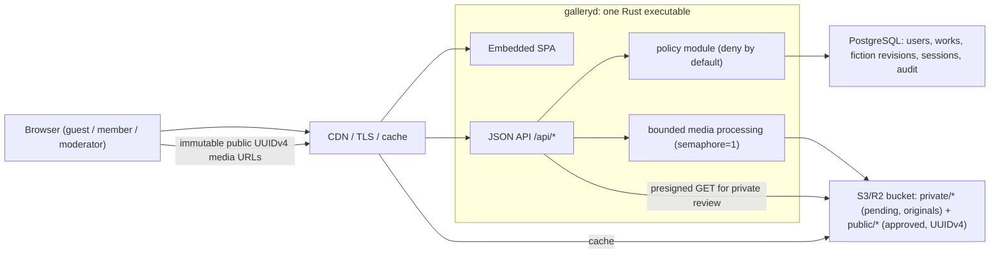

# Hasu Gallery Architecture V3 (Simplified)

- **Status**: Approved target architecture (2026-08-28). Supersedes
  `.ccg/spec/architecture-v2.md`, which is retained for history. S1 (single
  JSON contract), S2 (private media + UUIDv4 public URLs), and S3 (policy
  layer, security headers, works ETag) shipped 2026-08-28, and the production
  cutover completed the same day: `galleryd` serves the site same-origin at
  the public gallery domain (see `docs/deployment.md`).
- **Decision date**: 2026-08-28
- **Goal**: Deliver the same product outcomes (Meme + Art + Fiction, moderated
  UGC, private pending media, single-binary deploy) at the lowest sustainable
  complexity and maintenance cost for a small team / single maintainer on a
  1 vCPU / 512 MB origin.

## 1. Why Revisit V2

V2 is technically feasible — Slices A–C prove the hard parts (packaging,
Protobuf plumbing, Fiction domain) work. The problem is economic, not
technical:

1. **Dual API stacks are live today.** JSON `/api/*` (Meme/Art product) and
   Protobuf `/api/v2` (public works mirror + Fiction) coexist.
   `routes/works.rs` (860 lines) and `api_v2/public_works.rs` (637 lines)
   implement the same reads twice. Every future work-field change costs 2x
   until Slice G completes.
2. **The Protobuf transport is not load-bearing.** Same-origin fetch, cookie
   sessions, ETag caching, and CDN behavior are identical over JSON. The one
   claimed benefit — removing JSON field-name bytes — is already delivered by
   Brotli/gzip at the edge for these payload shapes and sizes. In exchange the
   repo carries: `proto/` schemas, prost + build.rs codegen,
   `packages/proto` TypeScript mirrors (~1,200 generated lines), a custom
   media type and codec (`api_v2/codec.rs`), binary error handling, buf
   lint/breaking gates, and curl/devtools-hostile debugging.
3. **Slices D–G exceed the remaining budget.** Presigned direct upload with a
   one-time session state machine, a four-variant media matrix
   (thumb/preview/display/master in webp+avif), an isolated worker subprocess,
   edge identity gates, moderator MFA + step-up auth, hash-chained audit,
   SBOM + artifact signing, and formal restore drills are enterprise controls.
   For this product's threat model and team size they are backlog items, not
   launch gates. As written, remaining V2 work is larger than everything built
   so far.

What V2 got right and V3 keeps:

- Single Rust executable (`galleryd`) embedding the SPA; no Node in prod.
- PostgreSQL as the only system of record; external S3/R2 for bytes.
- Fiction as a first-class kind with immutable revisions, atomic publish,
  series, and safe constrained markup (HFM) — the domain layer
  (`fiction/service.rs`, `fiction/markup.rs`, migrations 003–005) is
  transport-independent and survives unchanged.
- Private pending/original media; public URLs use UUIDv4 media IDs.
- Same-origin production, CORS disabled, deny-by-default authorization.
- Server-side filtering/pagination for large galleries.

## 2. Locked Decisions (V3)

| Area | V3 decision | Change vs V2 |
|---|---|---|
| Application shape | Modular monolith, one `galleryd` binary + embedded SPA | unchanged |
| API transport | **One JSON API** (serde), `/api/*` | replaces HTTP+Protobuf |
| API contract source | Rust handler types + `packages/types` TS types | replaces proto/ + buf + prost + protobuf-es |
| Database | PostgreSQL (managed or self-hosted) | unchanged |
| Object storage | One S3/R2 bucket, `private/` and `public/` key prefixes | replaces dual-bucket/dual-credential requirement (optional later) |
| Upload transport | Server-proxied streaming multipart (existing, bounded) | replaces presigned direct upload + upload_sessions |
| Private review access | Short-lived presigned **GET** URLs | replaces review-variant pipeline |
| Media variants | Sanitized original + one thumbnail (current model), UUIDv4 keys | replaces 4-variant × 2-format matrix |
| Media processing | In-process, bounded semaphore, concurrency 1 | replaces optional worker subprocess |
| Fiction storage | Versioned safe-markup text in PostgreSQL | unchanged |
| Authorization | One `policy` module, deny-by-default, called by every protected handler | unchanged in intent, simpler in mechanism |
| Sessions | tower-sessions, `__Host-` cookie, rotation (existing) | unchanged |
| Edge | Any CDN/proxy with TLS + caching (e.g. Cloudflare free tier) | drops WAF/bot-score/identity-gate/origin-shield as requirements |
| MFA, step-up, RLS, SBOM, signing, restore drills | Hardening backlog, not launch gates | demoted from requirements |

## 3. Target Architecture

Trust boundaries (unchanged in substance from V2 §5.1): edge is the only public
entry; PostgreSQL never public; `private/*` objects unreachable without a
short-lived signed URL; `public/*` contains only approved sanitized objects;
all client input untrusted after decoding; frontend guards are UX only.

## 4. API Contract

- One JSON contract under `/api`. The existing JSON surface
  (`docs/api.md`) is the base; Fiction routes are ported from Protobuf to JSON
  with the same paths and semantics:
  - `GET  /api/fictions`, `GET /api/fictions/{work_id}`,
    `GET /api/fiction-series/{series_id}`
  - `GET/POST /api/users/me/fictions`, `PUT .../{work_id}/draft`,
    `POST .../{work_id}/submit`
  - `GET /api/moderation/fictions`,
    `POST /api/moderation/fictions/{work_id}/revisions/{revision_id}/decision`
- Response shaping rules carried over from V2 §7.3 (they are about data
  hygiene, not transport): audience-specific projections (public / owner /
  moderation / admin), no server-owned fields accepted in updates, bounded
  strings and page sizes (max 50), stable product-safe error codes with
  request IDs, no internal SQL/storage details in responses.
- Public list/detail reads: `Cache-Control: public, max-age=30..120` +
  ETag (port the ETag logic from `api_v2/public_works.rs`). Public routes do
  not inspect cookies. Account/moderation/upload responses: `no-store`.
- Body limits enforced per route family (16 KiB auth, 64 KiB default, 2 MiB
  fiction revision) — keep the existing tiered-limit middleware, drop the
  Protobuf-specific media-type negotiation (415/406 logic simplifies to
  standard JSON handling).
- Shared types live in `packages/types` (already the pattern for the JSON
  API). Contract drift is caught by the existing component tests + backend
  HTTP tests; no buf toolchain.

**Deleted**: `proto/`, `backend/build.rs` protobuf step, `prost`/
`prost-build`/`protoc-bin-vendored` deps, `backend/src/proto.rs`,
`backend/src/api_v2/{codec,public_works}.rs` and the Protobuf shell of
`api_v2/fiction.rs` (handler/mapping logic is reused), `packages/proto`,
`apps/web/src/api/protobuf.ts`, buf lint/breaking CI steps.

## 5. Media Pipeline

Keeps the real security invariant (pending/original media must be private)
while reusing the shipped upload path.

1. **Upload** (unchanged shape): authenticated multipart to
   `POST /api/works/upload`, streamed to a bounded temp file, magic-byte
   sniffing, extension allowlist, dimension/pixel caps, 10 MB limit,
   per-route rate limit. No upload-session state machine, no object-store
   CORS surface.
2. **Storage layout**:
   ~~~text
   private/{media_uuid}/original.{ext}   -- as uploaded, retained per policy
   private/{media_uuid}/thumb.jpg        -- generated at upload time
   public/{media_uuid}/v1/image.{ext}    -- sanitized, published on approval
   public/{media_uuid}/v1/thumb.jpg
   ~~~
   `media_uuid` is a fresh UUIDv4, distinct from work ID; no user ID, work ID,
   filename, or hash appears in public URLs. Public objects are immutable
   (`public, max-age=31536000, immutable`); reprocessing bumps `v1` → `v2`.
3. **Sanitization** (current behavior, kept): re-encode JPEG/PNG (strips
   metadata); GIF/WebP keep container bytes but pass bounded decode
   validation (frame count, total pixels). Chunk-level WebP/GIF metadata
   stripping is backlog. SVG/PDF/archives rejected (already true).
4. **Review**: owner and moderators view pending media via presigned GET URLs
   (60–300 s expiry) issued by the API after a policy check. No public
   exposure of pending objects, no review-variant generation.
5. **Approval**: server-side copy `private/… → public/{media_uuid}/v1/…`
   inside the moderation transaction's success path; DB stores object keys and
   publication state; public URLs are derived, never stored denormalized.
6. **Takedown**: delete `public/*` objects, purge CDN, keep audit rows.
7. **Bounds**: one media job at a time (semaphore), decode limits enforced
   before full decode, temp files cleaned on every exit path. This is the
   part of V2 §8.7 that defends the 512 MB ceiling; the subprocess isolation
   option is backlog.

Data model: one `media_assets` table (id UUID, owner_id, state,
original_key, public_prefix/version, sha256, mime, width, height,
timestamps). No `media_variants` table (the variant set is fixed and tiny —
columns suffice). No `upload_sessions` table. Works reference
`media_assets.id`; Fiction covers/illustrations reference the same table.

## 6. Security: Invariants vs Backlog

Launch invariants (most already shipped):

- Server-side authz on every mutation and private read via one `policy`
  module: `fn allow(principal, action, resource) -> Decision`, deny by
  default, table-driven tests over role × action × resource state.
- Session hardening: `__Host-` + Secure + HttpOnly + SameSite=Lax, rotation
  on auth events, `session_version` revocation (existing/cheap).
- CSRF Origin/Referer validation on unsafe methods (existing).
- Rate limits on login/register/upload/fiction writes (existing).
- Bounded request bodies, bounded media decode, DB pool = 4, Argon2
  concurrency 1–2, global in-flight request cap, 429/503 shedding.
- Safe fiction markup: server-side HFM parse/validation, no raw HTML,
  HTTP(S)-only links, media references must be author-owned + approved
  (existing).
- Security headers middleware: HSTS, CSP without inline script,
  `frame-ancestors 'none'`, nosniff, Referrer-Policy, Permissions-Policy.
- Secrets outside the repo; no cookies/bodies/signed URLs in logs; request
  IDs + append-only `audit_events` for privileged actions.
- Backups: managed-Postgres PITR (or scheduled dumps) + bucket versioning.
  A documented restore procedure replaces formal drill gates.

Hardening backlog (do when the product earns it): moderator MFA/passkeys,
step-up auth, edge WAF/bot scoring, origin shielding, Postgres RLS, audit
hash-chaining, SBOM + artifact signing, media worker subprocess isolation,
presigned direct upload (only if origin upload bandwidth becomes a measured
problem).

## 7. Resource Budget

Same measurable targets as V2 §13 (they describe the 512 MB reality, not the
transport): idle RSS ≤ 90 MB, normal ≤ 160 MB, media peak ≤ 320 MB, hard
ceiling < 384 MB, pool 4, media concurrency 1, in-flight ≤ 64. Removing
prost/protobuf changes none of these materially; the binding constraints are
image decoding and Argon2, both semaphore-bounded.

## 8. Migration Plan (3 Slices, Each Reversible)

### S1 — Single JSON contract ✅ (shipped 2026-08-28)

- Fiction account/public/moderation routes ported to JSON handlers calling the
  existing `fiction::service` (`backend/src/routes/fiction.rs`); behavior
  preserved, paths moved from `/api/v2/*` to `/api/fictions*`,
  `/api/users/me/fictions*`, and `/api/moderation/fictions*`.
- `apps/web/src/api/fiction.ts` switched to JSON with shared types in
  `packages/types/src/fiction.ts`; `protobuf.ts` deleted.
- Deleted `proto/`, `packages/proto`, prost build plumbing, and all
  `api_v2` Protobuf codec/routes; the embedded-SPA fallback moved to
  `backend/src/spa.rs`; `/health` remains the JSON liveness probe.
- Removed the duplicate `hasu-gallery-api` bin target; `galleryd` is the one
  binary.
- Published fiction detail responses keep the `content_sha256` strong ETag.
  Porting ETag/micro-cache headers to the JSON works read path remains a
  follow-up (S3 or earlier).
- Rollback boundary: revert commit range; JSON Meme/Art surface untouched
  throughout.

### S2 — Private media + UUIDv4 public URLs ✅ (shipped 2026-08-28)

- Migration `006_media_assets.sql`: `media_assets` table
  (pending/public/removed states) + nullable `works.media_id`.
- New uploads write sanitized bytes to `private/{media_id}/original.{ext}` +
  `private/{media_id}/thumb.jpg` with a fresh UUIDv4 media ID distinct from
  the work ID; the upload response returns short-lived presigned preview URLs.
- Approval copies both objects server-side to `public/{media_id}/v1/...`
  before the moderation transaction commits (copies are compensated if the
  commit fails) and flips the media state to `public`. Public URLs are
  `{PUBLIC_MEDIA_BASE_URL}/public/{media_id}/v1/image.{ext}` — the object key
  is the URL path, so the CDN/proxy needs no rewrite rules, but it MUST refuse
  to serve `private/*` paths.
- Owner (`/api/users/me/works`), moderation queue, and authorized
  non-approved detail reads resolve pending/rejected media to 300 s presigned
  GET URLs (`backend/src/media.rs`); public contexts never emit private URLs.
- Takedown marks the media `removed`, deletes the public UUID objects (plus
  legacy-key copies for backfilled works), and keeps the private original for
  the retention window.
- `galleryd backfill-media` migrates legacy works: approved → copy to
  `public/{uuid}/v1/...` (legacy keys kept for the old-URL dual-read window);
  pending/rejected → move to `private/...` and delete the legacy publicly
  reachable objects, closing the pre-S2 exposure gap.
- Legacy works without a media row keep their original URL shape until
  backfilled; remove legacy approved objects after the rollback window closes.

### S3 — Policy consolidation + headers ✅ (code shipped 2026-08-28)

- `backend/src/policy.rs`: one pure deny-by-default `decide(principal,
  action)` covering work visibility (status × ownership), rated content,
  submission, and moderation; table-driven role × action × state tests.
  Works list/facets/detail, the moderation route guard, and Fiction
  auth/moderation checks all route through it.
- Security headers middleware on every response: `X-Content-Type-Options`,
  `Referrer-Policy`, `X-Frame-Options: DENY`, `Permissions-Policy`; a CSP
  (`script-src 'self'`, `frame-ancestors 'none'`, no unsafe-eval) on HTML
  documents only; HSTS gated on `SESSION_COOKIE_SECURE`.
- S1 leftover closed: public works list/detail responses carry a strong body
  ETag + `public, max-age=60, stale-while-revalidate=120` and honor
  `If-None-Match` — but only for session-independent variants
  (approved + all_ages). Rated/moderator variants stay uncacheable, and
  facets stay uncached because their output varies by session.
- Production cutover to the single-binary same-origin deploy is prepared in
  code (embedded SPA, same-origin CSRF, headers) and documented as an ops
  runbook in `docs/deployment.md`; the split topology stays supported until
  the cutover passes its rollback window.

Each slice ships behind the existing acceptance set: `pnpm test`,
`pnpm typecheck`, `pnpm build`, `cargo test`, local `pnpm e2e`.

## 9. Explicit Non-Goals

- No Protobuf/gRPC transport; no schema codegen toolchain.
- No SSR/Next.js; no frontend rewrite.
- No microservices, queues, or search daemons; PostgreSQL (`pg_trgm`)
  remains the search baseline.
- No second database engine.
- No presigned direct upload, media variant matrix, or AVIF pipeline until a
  measured bandwidth/latency problem justifies them.
- No enterprise edge stack (identity gate, bot scoring) as launch
  requirements.

## 10. Cost Comparison

| Dimension | V2 (as written) | V3 |
|---|---|---|
| Remaining migration slices | D, E, F, G (4 large) | S1–S3 (3 small) |
| API stacks to maintain until done | 2 (JSON + Protobuf) | 1 after S1 |
| Codegen toolchains | prost + protobuf-es + buf | none |
| Contract artifacts | proto/ + packages/proto + packages/types | packages/types |
| New state machines | upload_sessions + media pipeline states | media_assets states only |
| Object-store surface | dual buckets/credentials + upload CORS | one bucket, two prefixes, presigned GET |
| Per-endpoint change cost | message + mapping + TS mirror + JSON twin | handler + shared TS type |
| Debugging | binary bodies, custom media type | curl/devtools native |

## 11. Documentation Ownership

- This file is the target architecture source of truth.
- `.ccg/spec/architecture-v2.md` is superseded and retained for history.
- `.ccg/spec/roadmap.md` tracks S1–S3 migration state.
- `docs/api.md` documents the deployed JSON API.
- `docs/deployment.md` documents the deployed topology until the S3 cutover.
- `CLAUDE.md` provides the short agent-facing current/target boundary.

When a slice ships, update the roadmap, current API/deployment documents, and
CLAUDE entry point in the same change so target design, implementation state,
and operational instructions do not drift.
